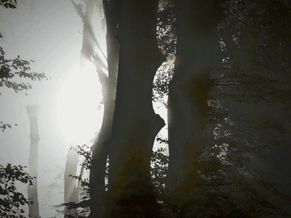
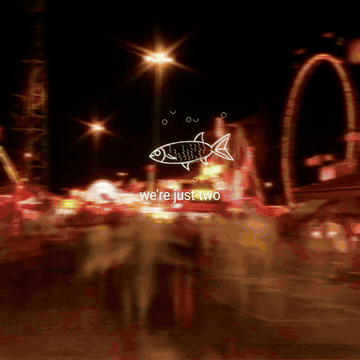

<div align="center">

# TikTok Edit Kit — Lite

**Beat-synced kinetic-text videos for TikTok, Reels and Shorts, made by Claude Code.**

[](#install)
[](LICENSE)


Give it a song and a few lines of words: big captions land on the beat, slams flash and shake,<br>
phrases whip out, and the video ends with the sound and loops without a seam.

</div>

## Install

In Claude Code, two commands:

```
/plugin marketplace add yefimchuk-mabel-insight/tiktok-edit-kit
/plugin install tiktok-edit-kit-lite@tiktok-edit-kit
```

Then just ask, in any language: *"make a kinetic text TikTok of these lines to my song"*.

On the first run Claude checks your machine and offers to install what's missing: Node 22+, ffmpeg, and Python 3 with numpy.
There is no Docker and no account, and **nothing is uploaded** — everything renders on your computer.

## What you get

| | |
|---|---|
| **On the beat** | `beatgrid.py` turns the song into the video length and the beat frames, and places your words on the hits (`--words "WE WERE \| so_we KEPT RUNNING!"`). |
| **The look** | Condensed caps fitted to the width, soft serif "breath" words, slams with a flash and a shake, an inverted frame, a phrase whip. |
| **The finish** | `finish.py` adds motion blur, bloom and grain without blending the cut frames. |
| **Checked before you post** | `verify.py` checks that the length equals the sound, that the flashes are bright and that the loop seam is clean. `sync.py` measures a real upload, sound vs. picture in ms. |
| **Your setup, proven** | `doctor.mjs` checks the machine; `selftest.py` proves every tool works and compiles on your Python. |

The rules inside come from real complaints: "not on the beat", "the end is silent", "the loop jumps".

## Pro: any edit → yours


Found an edit you love and there's no CapCut template for it? Give Claude **the video (or its link) and your clips or photos.**
Pro measures the edit frame by frame and rebuilds it on your footage. Before you see it, it checks the result against the
original, **shot by shot**:


| Film / travel | Dark film | Depth text | Cut-out layers |
|---|---|---|---|
|  |  |  |  |

- every cut, including 2-frame montages and dark intros; flashes, light leaks, inverts and the film gate;
- the grade of each shot (tone match), the motion inside each shot (motion match), and banding;
- a review page in your language, with **reference | yours** side by side;
- 8 building blocks;
- about 30 minutes to a first draft. The kit tells you up front which of your clips are too calm or missing.

**[TikTok Edit Kit Pro on Agensi →](https://www.agensi.io)**

<sub>Demo media: free stock clips/photos and template renders (credits: `docs/CREDITS.md`).</sub>

| | Lite (free) | Pro |
|---|---|---|
| Kinetic text on the beat | ✓ | ✓ |
| "Make it like this video" (a file or a link) | | ✓ |
| Shot-by-shot tone and motion match, side-by-side check | | ✓ |
| 8 building blocks for clips and photos | 1 | 8 |
| Edits without an example: style from your words | | ✓ |

## FAQ

**Does it post for me?** No. It makes the video file. You post it yourself.

**Why is my render silent?** On purpose: add the sound inside TikTok, so it plays from the start and the loop restarts with it.

**Does it need a GPU?** No. A native run on macOS or Windows is the fastest.

**Something broke.** Open an [issue](../../issues/new/choose) with the output of `node scripts/doctor.mjs` and the last lines of
the failing command.

## Licence

MIT. HyperFrames is a separate project with its own licence.
